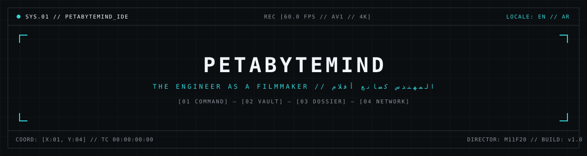

<div align="center">
  
</div>

# PetaByteMind // The Cinematic IDE & Systems Portfolio

> **"The Engineer as a Filmmaker."**  
> A dark-mode, cinematic Integrated Development Environment (IDE) merged with a non-linear video editor (DaVinci Resolve meets Linear and Bloomberg Terminal).

---


## Architecture & Workspaces

The application is structured around a persistent IDE Viewport Shell hosting four dedicated workspaces:

1. **`01 CMD` (The Command Center)**
   - **Hero Viewport**: 16:9 cinematic cyber-physical monitor with live SVG HUD displaying frame rate (`60.0 FPS`), SMPTE running timecode, broadcast safe-area guides, chapter scrubbers, and playback controls.
   - **Interactive System Topology**: Interactive SVG / canvas node graph interconnecting the 4 content pillars: *Systems Philosophy*, *Full-Stack Architecture*, *Vibe-Coding*, and *Hardware Mechanics*.
   - **Telemetry Inspector**: Real-time sidecar inspector reporting complexity score, measured latency benchmarks, and runtime stacks.

2. **`02 VAULT` (The Knowledge Vault)**
   - Complexity Filter bar (`00 ALL`, `01 Vibe-Coding Primer` → `02 Full-Stack Arch` → `03 Systems Design` → `04 Silicon Limits`).
   - Interactive 4-stage architecture pipeline (Kernel Bus `io_uring` → SIMD Dedup `AVX-512` → Raft Consensus Ring → Agent Dispatch `Tree-sitter`).
   - Timestamped kernel code snapshot cards with copyable source snippets.

3. **`03 DOSSIER` (Systems Blueprints)**
   - Architecture studies with **modeled design targets**, explicitly labeled as not yet measured.
   - Research Roadmap: Senior Graduation Project — *5G Private Networks & Network Slicing* on an SDR testbed. Measured SDR metrics and URLLC / mMTC / eMBB slice benchmarks replace the design studies as they land.

4. **`04 NETWORK` (The Global Network)**
   - Real intake pipeline: Turnstile → zod → rate limit → D1 → Slack webhook.
   - Live edge presence over a Durable Object WebSocket (country + Cloudflare POP only — no IPs stored).
   - Spotlights rendered from verified D1 members only.

---

## Design System & Token Discipline

| Token | Hex Value | Role |
| :--- | :--- | :--- |
| **Void Charcoal** | `#0B0E11` | Global base canvas and deepest viewport layer |
| **Graphite UI** | `#1F2428` | Compartments, cards, panels, structural elevation |
| **Border Slate** | `#2D333B` | Exposed 1px solid structural grid lines |
| **Muted Ash** | `#8B949E` | Secondary metadata, coordinates, low-priority telemetry |
| **Pure Signal** | `#F0F6FC` | Primary headings, code, and high-contrast typography |
| **Hyper Cyan** | `#34D3D5` | **<5% strict discipline**: Active states, triggers, cursors |

- **Zero Softness**: Explicit `rounded-none` geometry with visible 1px compartment borders and corner coordinate ticks (`SYS.01 // [X:1920, Y:1080]`).
- **Dual-Direction Grid Engine**: Built exclusively with CSS Logical Properties (`border-inline-start`, `ms-*`, `me-*`, `ps-*`, `pe-*`) for seamless LTR (`en`) / RTL (`ar`) mirroring while keeping code, coordinates, and telemetry strictly in Latin/English monospace.

---

## Edge Architecture (100% Cloudflare)

```
Browser ──HTTPS──▶ Worker (workers/entry.ts)
                    ├── /api/presence  ──WebSocket──▶ Durable Object `PresenceRoom` (hibernatable)
                    └── everything else ─▶ Next.js 16 via OpenNext
                          ├── /en, /ar           SSG, served from static assets
                          ├── /api/intake        Rate Limit → Turnstile → D1 → Slack (waitUntil)
                          ├── /api/telemetry     GET: request.cf edge info + p75 Web Vitals (KV 60s)
                          │                      POST: RUM beacon sink → D1
                          ├── /api/github        Latest commit + CI run (KV 120s)
                          └── /api/members       Verified spotlights (D1, KV 300s)
Cron 03:17 UTC ─▶ prune Web Vitals older than 30 days
```

| Concern | Service | Binding |
| :--- | :--- | :--- |
| Relational data | D1 + Drizzle ORM | `DB` |
| Read-heavy cache | Workers KV | `CACHE` |
| Real-time presence | Durable Objects (SQLite-backed) | `PRESENCE` |
| Abuse protection | Workers Rate Limiting + Turnstile | `INTAKE_LIMITER`, `TELEMETRY_LIMITER` |

Vault snippets and Blueprints content ship in the JS bundle (`src/data/content.ts`): the CDN serves them with zero lookups, which beats any KV read.

**Every number shown is measured or labeled.** Build status comes from the GitHub API. RTT is `request.cf.clientTcpRtt` and POP is `request.cf.colo`. FPS comes from `requestAnimationFrame`, the live count from the DO, and P75 LCP/INP/CLS from real visitors. Design targets are labeled *modeled*.

---

## Quickstart

```bash
npm ci
cp .dev.vars.example .dev.vars          # Turnstile always-pass test secret
npm run db:migrate:local
npm run dev                             # Next.js dev with D1/KV/rate-limit bindings via Miniflare
npm run preview                         # Full Worker incl. Durable Object WebSockets on :8787
```

### Quality gates
```bash
npm run typecheck && npm run lint
npm run build && npm run test:e2e       # Playwright: EN/AR × desktop/tablet/mobile, overflow + content integrity
npm run cf:build && scripts/smoke.sh    # Real Worker: D1, KV, DO, rate limits
```

### Database
```bash
# edit src/server/db/schema.ts, then:
npm run db:generate
npm run db:migrate:local
# approve an intake / publish a spotlight:
npx wrangler d1 execute petabytemind --remote --command "UPDATE intake_requests SET status='approved' WHERE id=1"
npx wrangler d1 execute petabytemind --remote --command "INSERT INTO members (handle,display_name,location,hub,discipline,project,project_url,approved_at) VALUES ('handle','Name','Baghdad, IQ','MENA','Distributed Systems','Project','https://github.com/...',unixepoch()*1000)"
```

### CI/CD

| Stage | Owner | What runs |
| :--- | :--- | :--- |
| Quality gate | GitHub Actions (`.github/workflows/ci.yml`) | tsc, eslint (0 warnings), schema↔migration drift, Playwright EN/AR × 3 viewports, real-Worker smoke test |
| Preview | Cloudflare Workers Builds (default `npx wrangler versions upload`) | Non-`main` branches: build hook → preview version. Never touches production or the DB schema |
| Production | Cloudflare Workers Builds (default `npx wrangler deploy`) | `main`: build hook → ensure D1 exists → migrations → deploy |

The build hook (`wrangler.jsonc` → `build.command` → `scripts/build-worker.sh`) makes Cloudflare's **default** build settings work with no dashboard commands. `cloudflare/open-next.config.ts` lives outside the repo root on purpose: a root-level `open-next.config.*` makes wrangler hand `deploy` off to `opennextjs-cloudflare deploy`, which skips the build.

**One-time Cloudflare setup** (Workers & Pages → `petabytemind` → Settings):

| Where | Setting | Value |
| :--- | :--- | :--- |
| Build | Build / deploy commands | Defaults (build empty, `npx wrangler deploy`, `npx wrangler versions upload`) |
| Build → Variables | `NEXT_PUBLIC_TURNSTILE_SITE_KEY` | Turnstile site key (build-time) |
| Variables & Secrets | `TURNSTILE_SECRET_KEY` | Turnstile secret (intake returns 503 until set) |
| Variables & Secrets | `SLACK_WEBHOOK_URL` | *(optional)* Slack Incoming Webhook |
| Variables & Secrets | `GITHUB_TOKEN` | *(optional)* read-only token for higher GitHub API limits |

In GitHub, mark the `CI` jobs as required checks on `main`.

### Keyboard Shortcuts
- `Cmd + K` or `Ctrl + K`: Open Command Palette / Dispatch Protocol
- `Esc`: Close Command Palette
